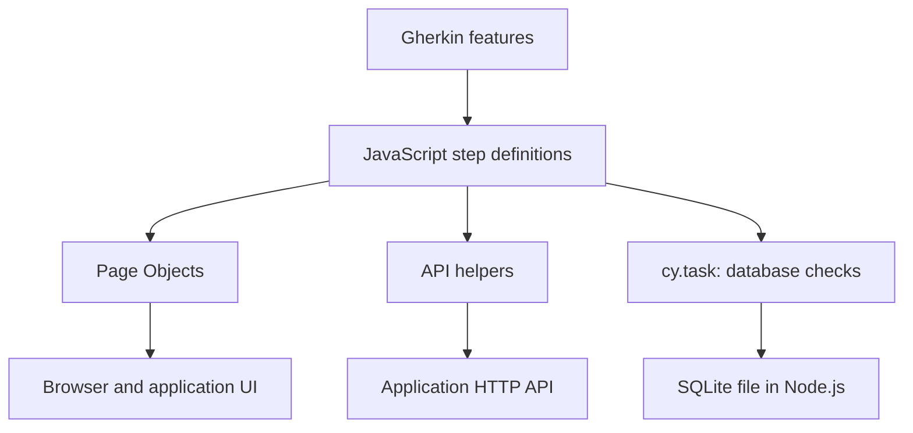

# Bookstore Tests — Cypress

JavaScript test automation for **Hub de Leitura**, a library/bookstore training application. This project combines browser journeys, HTTP API checks, cross-endpoint integration checks, and read-only SQLite validation with Cypress and Cucumber.

Scenarios are written in English Gherkin; application labels and validation messages are mostly in Portuguese. Browser tests use Page Objects, API tests use reusable request helpers, and database queries execute through Cypress's Node-side tasks.

> **Status:** this README documents the committed implementation, not a claim that all scenarios pass. Read [Known issues](#known-issues) before treating a run as complete regression coverage. Cypress was not executed during this documentation review.

## Contents

- [Scope and coverage](#scope-and-coverage)
- [Architecture](#architecture)
- [Technology stack](#technology-stack)
- [Repository layout](#repository-layout)
- [Requirements](#requirements)
- [Local setup](#local-setup)
- [Configuration](#configuration)
- [Running tests](#running-tests)
- [Browser tests](#browser-tests)
- [API tests](#api-tests)
- [Database tests](#database-tests)
- [Test data and isolation](#test-data-and-isolation)
- [Formatting and linting](#formatting-and-linting)
- [Continuous integration](#continuous-integration)
- [Reports and debugging](#reports-and-debugging)
- [Adding tests](#adding-tests)
- [Known issues](#known-issues)
- [Troubleshooting](#troubleshooting)
- [Contributing](#contributing)
- [License](#license)

## Scope and coverage

The application under test lives in a separate repository: [hub-de-leitura-integrado](https://github.com/julianoaperes/hub-de-leitura-integrado). This repository contains tests and tooling; installing its dependencies does not start the application.

### Feature inventory

| Layer           | Feature                                                                | Main checks                                                                                       | Expanded examples |
| --------------- | ---------------------------------------------------------------------- | ------------------------------------------------------------------------------------------------- | ----------------: |
| Browser         | [home.feature](cypress/e2e/home.feature)                               | Sections, featured books/covers, navigation, categories, contact validation                       |                17 |
| Browser         | [login.feature](cypress/e2e/login.feature)                             | Authentication, invalid credentials, required fields, malformed email                             |                10 |
| Browser         | [register.feature](cypress/e2e/register.feature)                       | Creation, optional phone, validation boundaries, password visibility, duplicate email, navigation |                21 |
| Browser         | [catalog.feature](cypress/e2e/catalog.feature)                         | Search, filters, empty results, pagination, grid/list views, details, basket                      |                28 |
| API             | [books.feature](cypress/e2e/api/books.feature)                         | Response structure, page sizes, search, filters, stock, nonoverlapping pages                      |                20 |
| API             | [book-details.feature](cypress/e2e/api/book-details.feature)           | Details, availability/statistics consistency, missing and malformed IDs                           |                 5 |
| API             | [categories.feature](cypress/e2e/api/categories.feature)               | Shape, uniqueness, accents, totals, agreement with books endpoint                                 |                 7 |
| API             | [login-api.feature](cypress/e2e/api/login-api.feature)                 | Token issuance, incorrect credentials, empty and omitted fields                                   |                 9 |
| API             | [register-api.feature](cypress/e2e/api/register-api.feature)           | Account creation, subsequent login, duplicate email, required fields                              |                 9 |
| API integration | [catalog-integration.feature](cypress/e2e/catalog-integration.feature) | Category → filtered books → selected book details                                                 |                 1 |
| Database        | [books-database.feature](cypress/e2e/database/books-database.feature)  | Integrity, tables, stock, foreign keys, API/database record and total comparisons                 |                 6 |

There are **11 feature files and 133 statically expanded examples**, counting each Scenario Outline example row separately. These are source counts, not executed or passing results. Focus markers, step conflicts, or failures can reduce execution.

The integration feature sits directly under `cypress/e2e/`; selecting only `cypress/e2e/api/` does not include it.

### Coverage boundaries

- Authentication checks token issuance, not authorization on protected endpoints.
- Browser validation does not establish equivalent backend validation.
- Database scenarios inspect books and schema. They do not yet verify user-registration persistence or bcrypt hashes.
- Contact scenarios cover validation, not successful message persistence.
- Basket UI scenarios cover adding books and persistence after reload, not reservation checkout or authenticated basket API behavior.
- No performance suite, accessibility audit, security scan, deployment, Cypress Cloud recording, or Allure reporter is configured.

## Architecture



| Component                              | Responsibility                                                            |
| -------------------------------------- | ------------------------------------------------------------------------- |
| `.feature` files                       | Describe inputs, actions, and expected behavior                           |
| Step definitions                       | Connect Gherkin expressions to reusable code and assertions               |
| `pages/`                               | Centralize browser selectors, interactions, navigation, and UI assertions |
| `api/`                                 | Send real requests; `BooksApi` also groups reusable response assertions   |
| `cypress/tasks/database.cjs`           | Execute named SQLite queries in Node.js and return rows                   |
| Cypress/Cucumber/esbuild configuration | Discover features, load shared steps, register tasks, bundle tests        |

API checks do not require `cy.visit()` or a Page Object, but still execute through Cypress. SQLite access happens in Node.js rather than browser JavaScript.

## Technology stack

Declared versions below come from [package.json](package.json). The [lockfile](package-lock.json) records resolved dependencies; use `npm ci` for a locked installation.

| Dependency                   | Declared version       | Purpose                                             |
| ---------------------------- | ---------------------- | --------------------------------------------------- |
| Cypress                      | `^16.2.1`              | Browser execution, HTTP requests, tasks, assertions |
| Cucumber preprocessor        | `^28.0.1`              | Gherkin execution and step matching                 |
| Cypress esbuild preprocessor | `^2.2.8`               | File preprocessing                                  |
| esbuild                      | `^0.28.2`              | Bundling                                            |
| Faker                        | `^10.6.0`              | Unique synthetic registration emails                |
| sqlite3                      | `^6.0.1`               | Node-side SQLite queries                            |
| ESLint / `@eslint/js`        | `^10.14.0` / `^10.0.1` | JavaScript checks and recommended rules             |
| eslint-plugin-cypress        | `^7.0.4`               | Cypress-specific lint checks                        |
| eslint-config-prettier       | `^10.1.8`              | Disable conflicting formatting rules                |
| globals                      | `^17.14.0`             | ESLint runtime globals                              |
| Prettier                     | `3.9.10`               | Source formatting                                   |

Backend dependencies, including Express and its SQLite driver, are installed separately. The npm package name remains `cypress-cucumber2`; the repository is named `bookstore-tests-cypress`. That naming difference does not affect execution.

## Repository layout

| Location                                                                       | Contents                                                               |
| ------------------------------------------------------------------------------ | ---------------------------------------------------------------------- |
| [cypress/e2e/](cypress/e2e/)                                                   | Browser features and catalog API integration feature                   |
| [cypress/e2e/api/](cypress/e2e/api/)                                           | Five API feature files                                                 |
| [cypress/e2e/database/](cypress/e2e/database/)                                 | SQLite validation feature                                              |
| [cypress/support/step_definitions/](cypress/support/step_definitions/)         | Shared step implementations                                            |
| [cypress/support/e2e.js](cypress/support/e2e.js)                               | Support entry point; imports custom commands                           |
| [cypress/support/commands.js](cypress/support/commands.js)                     | Custom `Login` command and scaffold comments; see known issues         |
| [cypress/tasks/database.cjs](cypress/tasks/database.cjs)                       | Six named read-only database tasks                                     |
| [cypress/fixtures/example.json](cypress/fixtures/example.json)                 | Unused scaffold fixture                                                |
| [pages/](pages/)                                                               | Four Page Objects                                                      |
| [api/](api/)                                                                   | `AuthApi` and `BooksApi`                                               |
| [utils/userFactory.js](utils/userFactory.js)                                   | Empty placeholder; generation currently lives in registration steps    |
| [cypress.config.cjs](cypress.config.cjs)                                       | Cypress, Cucumber, esbuild, tasks, base URL                            |
| [.cypress-cucumber-preprocessorrc.json](.cypress-cucumber-preprocessorrc.json) | Step-definition discovery                                              |
| [eslint.config.mjs](eslint.config.mjs)                                         | ESLint flat configuration                                              |
| [.prettierrc.json](.prettierrc.json) / [.prettierignore](.prettierignore)      | Formatting rules/exclusions                                            |
| [.vscode/settings.json](.vscode/settings.json)                                 | Optional format-on-save settings                                       |
| [.github/workflows/cypress-tests.yml](.github/workflows/cypress-tests.yml)     | Application startup, Cypress execution, artifacts, formatting, linting |

CI creates `bookstore-app/` by checking out the backend. It is not tracked test-project source.

## Requirements

- Git and npm.
- **Node.js 24**, matching the committed CI workflow. Other versions were not validated during this documentation review.
- Network access for dependencies, the Cypress executable, and backend checkout.
- Hub de Leitura running at `http://localhost:3000`.
- A registered test account for positive authentication checks.
- Access to the running backend's `database/biblioteca.db` file for database checks.
- Chrome for `--browser chrome`, or the default bundled Electron browser.
- A desktop environment for interactive mode. Linux headless execution also needs Cypress system dependencies; CI uses GitHub's Ubuntu runner image.

```bash
node --version
npm --version
git --version
```

## Local setup

### 1. Install the test project

```bash
git clone https://github.com/julianoaperes/bookstore-tests-cypress.git
cd bookstore-tests-cypress
npm ci
```

Development dependencies contain the test toolchain and must be installed. `npm ci` requires a lockfile consistent with `package.json` and replaces existing `node_modules`. Use `npm install` when intentionally changing dependencies, and commit both package files.

### 2. Start the application separately

In a second terminal, clone the backend beside the test repository:

```bash
git clone https://github.com/julianoaperes/hub-de-leitura-integrado.git
cd hub-de-leitura-integrado
git checkout 5b69f92b763e50e3404778fb56c9c359793d37cb
npm ci
npm start
```

The checkout selects CI's pinned backend revision in detached-HEAD mode. Leave the server running while tests execute.

| Resource          | URL                                   |
| ----------------- | ------------------------------------- |
| Home              | `http://localhost:3000/index.html`    |
| Login             | `http://localhost:3000/login.html`    |
| Registration      | `http://localhost:3000/register.html` |
| Catalog           | `http://localhost:3000/catalog.html`  |
| Health            | `http://localhost:3000/api/health`    |
| API documentation | `http://localhost:3000/api-docs`      |

The backend opens `database/biblioteca.db` through `config/db.js`. A fresh checkout includes the database. Do not repeatedly run its `npm run db` initializer against that file: it inserts sample records and changes stock; it is not an idempotent reset.

### 3. Configure credentials and database access

Create `cypress.env.json` in the **test project root**:

```json
{
  "LOGIN_EMAIL": "usuario@teste.com",
  "LOGIN_PASSWORD": "user123",
  "DB_PATH": "../hub-de-leitura-integrado/database/biblioteca.db"
}
```

These are the backend's documented public training-account credentials, not production credentials. Verify the account exists locally; substitute your registered test account if necessary.

`DB_PATH` can be absolute or relative to the **test project root**. A Windows example is:

```json
{
  "DB_PATH": "C:/projects/hub-de-leitura-integrado/database/biblioteca.db"
}
```

Use forward slashes to avoid JSON escaping. Target the database used by the running server, not a separate downloaded copy. `cypress.env.json` is ignored by Git.

The current positive UI login scenario uses literal credentials that differ from these settings; see [Known issues](#known-issues).

### 4. Verify Cypress and open the runner

```bash
npx cypress verify
npm run cy:open
```

Select E2E Testing, a browser, and a feature. Resolve the documented step-definition conflict before expecting affected scenarios to run successfully.

## Configuration

### Cypress and shared steps

The existing asynchronous `setupNodeEvents()` registers Cucumber, database tasks, and the esbuild file preprocessor, then returns `config`. Add integrations to that handler rather than replacing it with a second handler.

The spec pattern is `cypress/e2e/**/*.feature`; ordinary `.cy.js` files are not selected. The shared step-definition configuration is:

```json
{
  "stepDefinitions": ["cypress/support/step_definitions/**/*.js"]
}
```

Expressions are shared across features. Separate JavaScript filenames do not isolate duplicate step text.

| Setting          | Consumer                                            | Required for                      |
| ---------------- | --------------------------------------------------- | --------------------------------- |
| `LOGIN_EMAIL`    | Login API and parameterless valid-email UI step     | Configured-account authentication |
| `LOGIN_PASSWORD` | Login API and parameterless valid-password UI steps | Configured-account authentication |
| `DB_PATH`        | `config.env.DB_PATH` in Node-side tasks             | Database scenarios                |
| `e2e.baseUrl`    | Relative `cy.visit()` calls                         | Login/registration navigation     |

CI supplies Cypress values through `CYPRESS_LOGIN_EMAIL`, `CYPRESS_LOGIN_PASSWORD`, and `CYPRESS_DB_PATH`.

### Changing environments

The configured base URL is `http://localhost:3000/`. However, `AuthApi`, `BooksApi`, `HomePage`, and `CatalogPage` also contain absolute localhost URLs. Changing only `baseUrl` does not retarget the full suite.

Centralize or update all target URLs before changing host/port. Database comparisons require the matching environment's SQLite file; an HTTP URL does not provide filesystem access.

## Running tests

Run commands from the test repository with the backend already running.

| Goal                    | Command                                                              |
| ----------------------- | -------------------------------------------------------------------- |
| Interactive runner      | `npm run cy:open`                                                    |
| All discovered features | `npm run cy:run`                                                     |
| Chrome                  | `npm run cy:run -- --browser chrome`                                 |
| One browser feature     | `npm run cy:run -- --spec "cypress/e2e/catalog.feature"`             |
| Five API features       | `npm run cy:run -- --spec "cypress/e2e/api/**/*.feature"`            |
| API integration         | `npm run cy:run -- --spec "cypress/e2e/catalog-integration.feature"` |
| Database suite          | `npm run cy:run -- --spec "cypress/e2e/database/**/*.feature"`       |

Run all four browser features:

```bash
npm run cy:run -- --spec "cypress/e2e/home.feature,cypress/e2e/login.feature,cypress/e2e/register.feature,cypress/e2e/catalog.feature"
```

Run API features together with API integration:

```bash
npm run cy:run -- --spec "cypress/e2e/api/**/*.feature,cypress/e2e/catalog-integration.feature"
```

The npm `--` forwards options to Cypress. Quote patterns so Cypress receives them consistently across shells. Failed runs return a nonzero exit code.

**Do not use `npm test`:** it remains the scaffold command that prints `Error: no test specified` and exits with code 1. Use `npm run cy:run`.

## Browser tests

| Page Object                              | Responsibility                                                                                   |
| ---------------------------------------- | ------------------------------------------------------------------------------------------------ |
| [HomePage.js](pages/HomePage.js)         | Sections, featured books, header/footer navigation, categories, contact form                     |
| [LoginPage.js](pages/LoginPage.js)       | Inputs, submission, errors, required-field/email-validity assertions                             |
| [RegisterPage.js](pages/RegisterPage.js) | Fields, terms, password toggle, invalid styling, navigation; success currently asserts dashboard |
| [CatalogPage.js](pages/CatalogPage.js)   | Search, filters, exact card matching, pagination, views, basket, details navigation              |

Objects are exported as reusable instances. Element methods query the current DOM instead of caching elements. Update selectors in the relevant Page Object when application markup changes.

Native email checks read `validity.typeMismatch` or `validity.valueMissing`. Registration's custom validation checks `is-invalid`. These assertions test different mechanisms and do not substitute for server validation.

Password typing generally disables command logging. Literal input methods disable special-character parsing. Use synthetic credentials because feature arguments, failing assertions, screenshots, and videos can still expose values.

Catalog search is asynchronous. Prefer retryable assertions or waits for explicitly matched requests when improving synchronization; avoid arbitrary fixed delays. Basket browser storage and SQLite records have separate lifecycles.

## API tests

Helpers send real requests with `cy.request()`. Current suites do not configure network stubs. `failOnStatusCode: false` preserves negative responses for assertions; it does not assert success.

| Method/route                | Helper               | Main expectations                                                                  |
| --------------------------- | -------------------- | ---------------------------------------------------------------------------------- |
| `GET /api/books`            | `getBooks(query)`    | `books`, `pagination`, `filters`, searches, filters, stock                         |
| `GET /api/books/:id`        | `getBookById(id)`    | `book`, `availability`, `statistics`, 200/400/404 examples                         |
| `GET /api/books/categories` | `getCategories()`    | Names, counts, availability quantities, total                                      |
| `POST /api/login`           | `login(credentials)` | Success token; missing-input and incorrect-credential rejection                    |
| `POST /api/register`        | `register(user)`     | Creation, subsequent login, required fields; duplicate-status mismatch noted below |

These five tested routes are not a complete backend inventory.

Book requests encode `page`, `limit`, `search`, `category`, `editor`, and `available` through `qs`. Login sends `{ email, password }`; registration sends `{ name, email, password }` with optional `phone`. Browser-only confirmation and terms controls are not part of the observed registration API payload.

Two-column Gherkin query tables become objects with `rowsHash()`; named-column tables use `hashes()`. Scenario aliases hold responses, selected records, and saved IDs.

The suite compares complete title sets, stock quantities, pagination metadata, category totals, and list/detail records. Registration success includes a subsequent login. Category `availableBooks` is not treated as a distinct-title count: the sample response can exceed `bookCount`.

The integration scenario selects an existing populated category, fetches a book, then requests that book's details. This reduces hardcoded data for that journey while checking agreement between endpoints.

## Database tests

[database.cjs](cypress/tasks/database.cjs) registers six tasks:

| Task                      | Argument         | Check                                           |
| ------------------------- | ---------------- | ----------------------------------------------- |
| `db:integrity`            | None             | `PRAGMA integrity_check`; expects `ok`          |
| `db:tables`               | None             | Application tables from `sqlite_master`         |
| `db:bookById`             | Positive integer | Selected `Books` columns using `WHERE id = ?`   |
| `db:bookCount`            | None             | Total `Books` rows                              |
| `db:invalidStock`         | None             | Null, noninteger, negative, or over-total stock |
| `db:foreignKeyViolations` | None             | `PRAGMA foreign_key_check`                      |

Each query validates the configured path, opens SQLite with `OPEN_READONLY`, applies a five-second busy timeout, retrieves rows, and closes the connection before resolving. Missing files fail explicitly instead of silently creating an empty database. Only named operations are exposed, rather than arbitrary SQL supplied by browser tests.

The schema check requires `Users`, `Books`, `Contacts`, `Reservations`, `LoanHistory`, `Wishlist`, `Basket`, and `BookReviews`, but allows additional tables. It does not validate every column or index.

API/database comparisons use book ID 2 and compare ID, title, author, ISBN, publisher, category, and stock. The catalog-total check compares the database count with the API's complete `pagination.total`, not one page's length.

These reads do not share a transaction/snapshot. Avoid concurrent catalog changes during consistency checks. Read-only tasks do not make registration scenarios read-only; those write users through the application.

## Test data and isolation

- Registration steps use `faker.string.uuid()` for unique emails and synthetic names/passwords.
- `utils/userFactory.js` is empty; it is not yet a shared data factory.
- Browser isolation is not explicitly overridden in Cypress configuration. Preserve isolation and avoid reliance on another scenario's login or basket.
- Browser-state resets do not delete SQLite users or restore stock.
- No automatic cleanup of created registration accounts is implemented.
- Use disposable local/CI training data, not production data.
- CI checks out a separate backend/database for each job; local backend changes are not included automatically.

Several tests depend on sample data: 23 books, 12 first-page grid cards, five Fantasia books, ID 2 named `1984`, no História books/category, and no unavailable titles. Fixture changes can invalidate these expectations. Review requirements before changing assertions.

## Formatting and linting

| Command                | Effect                                 |
| ---------------------- | -------------------------------------- |
| `npm run format`       | Apply Prettier                         |
| `npm run format:check` | Check formatting without edits         |
| `npm run lint`         | Run ESLint                             |
| `npm run lint:fix`     | Apply supported fixes; review the diff |

Prettier uses semicolons, double quotes, two spaces, trailing commas, and LF endings. Its ignore file excludes dependencies, CI backend checkout, generated outputs, lockfile, local Cypress settings, and SQLite files. No Gherkin formatting plugin is installed, so this setup does not format `.feature` files.

ESLint applies recommended JavaScript rules, Node/CommonJS globals to `.cjs` files, and browser/Mocha/Cypress globals plus Cypress rules to test code, Page Objects, API helpers, and utilities. Configured unused identifiers prefixed with `_` are permitted. `eslint-config-prettier` disables conflicting rules; it does not execute Prettier.

Optional VS Code settings enable Prettier on save with its extension installed. Other IDEs can consume the same formatting configuration; npm checks do not depend on VS Code.

```bash
npm run format:check
npm run lint
npm run cy:run
```

## Continuous integration

Workflow: [Cypress - UI, API and Database Tests](.github/workflows/cypress-tests.yml). See executions in [GitHub Actions](https://github.com/julianoaperes/bookstore-tests-cypress/actions).

### Triggers and runtime

- Pushes to `main`, pull requests targeting `main`, and manual dispatch.
- Ubuntu 24.04, Node.js 24, Chrome, and a 30-minute job timeout.
- Read-only repository contents permission; superseded runs for the same workflow/ref are cancelled.

### Current execution order

1. Check out the test repository.
2. Check out the backend into `bookstore-app/` at `5b69f92b763e50e3404778fb56c9c359793d37cb`.
3. Set up Node and npm caching for both lockfiles.
4. Install test and backend dependencies with `npm ci`.
5. Verify the database file exists.
6. Start the application on port 3000 with `NODE_ENV=production` to suppress browser opening.
7. Poll `/api/health` up to 60 times; print the server-log tail on timeout.
8. Run Cypress with Chrome, videos, and JUnit output.
9. Attempt artifact upload regardless of prior success/failure.
10. Attempt backend cleanup regardless of prior success/failure.
11. Run formatting and lint checks.

Formatting/lint steps currently appear **after** Cypress and do not use `always()`: an earlier failure skips them. Moving them immediately after dependency installation is a recommended follow-up for faster feedback, not current behavior.

CI sets the sample login values and an absolute `CYPRESS_DB_PATH`. It does not copy personal local configuration, require a Cypress Cloud key, or use GitHub secrets. Its JWT key is a temporary training value.

This is continuous integration, not deployment. There is no publishing, environment promotion, automatic merge, or branch-protection configuration. Update the pinned backend revision deliberately when validating application changes.

## Reports and debugging

The CI reporter command is:

```bash
npm run cy:run -- --browser chrome --config video=true --reporter junit --reporter-options "mochaFile=cypress/results/results-[hash].xml,toConsole=true"
```

For local use, create `cypress/results` first.

| Output              | Location/behavior                                                                   |
| ------------------- | ----------------------------------------------------------------------------------- |
| Terminal results    | Cypress output                                                                      |
| JUnit XML           | `cypress/results/results-[hash].xml` with reporter options supplied                 |
| Failure screenshots | `cypress/screenshots/` when captured                                                |
| Videos              | `cypress/videos/` with `video=true`; local config does not enable videos explicitly |
| CI artifact         | `cypress-results-<run attempt>`, retained seven days                                |
| Backend startup log | Runner temporary directory; last 80 lines printed on startup timeout                |

Download artifacts from the run page. Upload uses `always()` and ignores missing files; no report or screenshot can be uploaded before it has been generated. JUnit files are artifacts, not a separately published test dashboard.

Use interactive Cypress to inspect browser steps. For API failures, compare the response against the backend contract. Database failures can originate in Node-side file access or SQL even though Cypress displays the failure.

Allure output names occur in ignore lists only; no Allure reporter is installed/configured.

## Adding tests

1. Add a `.feature` in the appropriate directory. Keep integration placement explicit in spec selection.
2. Add/reuse steps under `cypress/support/step_definitions/` without duplicate expressions.
3. Put selectors/actions in Page Objects, requests in API helpers, and database operations in named Node tasks.
4. Parameterize SQL values and retain read-only access unless a separately designed fixture workflow needs writes.
5. Assert HTTP status and meaningful response fields. Require nonempty collections before looping over all results.
6. Use independent setup and unique mutation data; design cleanup before expanding persistent fixtures.
7. Remove temporary focus markers, run checks, and update relevant documentation.

Example using existing shared definitions:

```gherkin
Scenario: Find a known book
  When I request books with these query parameters:
    | search | 1984 |
    | limit  | 10   |
  Then the books API status should be 200
  Then the books API should return exactly these titles:
    | title |
    | 1984  |
```

Do not weaken assertions solely to make CI green. Determine whether the application, fixture, or test contract is incorrect.

## Known issues

These findings come from source review and were not silently fixed by this documentation update.

| Finding                                                                  | Effect                                                                 | Follow-up                                                                                    |
| ------------------------------------------------------------------------ | ---------------------------------------------------------------------- | -------------------------------------------------------------------------------------------- |
| `login.steps.js` registers `I type a valid password` twice               | Ambiguous matching when used                                           | Retain one intended implementation                                                           |
| `RegisterPage.js` declares `assertPasswordValue()` twice                 | Later member overrides the earlier one; lint can reject duplicates     | Keep one corrected implementation and remove stale comments                                  |
| `catalog.feature` retains `@only` on publisher filtering                 | Committed focus marker makes regression intent uncertain               | Remove it and confirm actual executed counts                                                 |
| Positive `login.feature` uses `jp.teste@teste.com` / `123456` literally  | CI environment values do not replace those strings                     | Use configured-account steps or provision the synthetic account deliberately                 |
| Registration API duplicate test expects 409                              | Pinned backend returns 400 for an existing email                       | Agree on the contract and align the backend or scenario                                      |
| Catalog page two expects both 11 cards and `Exibindo 11 de 23 livros`    | Pinned frontend computes cumulative `Exibindo 23 de 23 livros`         | Separate label semantics from rendered-card count                                            |
| Custom `Login` command uses `/` and `.should.have.text(...)`             | Wrong page for login fields and invalid assertion syntax if invoked    | Use the login page and `.should("have.text", ...)`; feature steps currently use Page Objects |
| `CatalogPage.bookCard()` has unused `index`                              | Can fail `no-unused-vars`                                              | Rename `_index` or refactor                                                                  |
| Absolute localhost URLs remain                                           | `baseUrl` alone cannot retarget all tests                              | Centralize environment configuration                                                         |
| `.gitignore` omits `cypress/results/` and `bookstore-app/`               | Generated reports/local backend checkout can appear as untracked files | Add exclusions when generating those paths locally                                           |
| Registration has no cleanup and several assertions use fixed sample data | Repeated runs persist users; altered fixtures affect results           | Use disposable fixtures and deliberate resets/cleanup                                        |

A standalone license file, deployment job, implemented shared user factory, and proof of an all-green suite are not included. Consult actual run logs rather than inferring success from feature presence.

## Troubleshooting

| Symptom                                           | Checks/action                                                                                      |
| ------------------------------------------------- | -------------------------------------------------------------------------------------------------- |
| `npm test` immediately fails                      | Use `npm run cy:run`                                                                               |
| Lockfile mismatch                                 | Resolve dependency changes with `npm install`; review and commit both package files                |
| Cypress executable missing                        | Run `npx cypress install`, then `npx cypress verify`; check network/proxy/cache                    |
| Chrome missing                                    | Install Chrome or use default Electron                                                             |
| Port 3000 connection refused                      | Start backend; check `/api/health` and port conflicts                                              |
| No specs                                          | Check working directory, `.feature` extension, and spec pattern                                    |
| Missing/ambiguous step                            | Check shared discovery, exact text, duplicate definitions                                          |
| Login configuration assertion fails               | Set test-root `cypress.env.json` or corresponding `CYPRESS_` variables                             |
| API login works but UI login fails                | Check literal feature credentials and duplicate password step                                      |
| Missing `DB_PATH`                                 | Set the backend file path consumed by `config.env.DB_PATH`                                         |
| Database not found                                | Resolve paths from test root; avoid empty/separate copies                                          |
| API/database mismatch                             | Confirm same file/backend revision and no concurrent changes                                       |
| Native SQLite module error                        | Reinstall dependencies for the intended Node version; do not copy another machine's `node_modules` |
| Database locked                                   | Check concurrent writers/open transactions; task busy timeout is five seconds                      |
| Catalog count mismatch                            | Check fixtures, filters, focus markers, and page-two label/card semantics                          |
| Duplicate registration returns 400 instead of 409 | Review the pinned backend contract                                                                 |
| Formatting/lint failure                           | Run the same check locally; inspect output and automatic-fix diff                                  |
| Missing CI artifact                               | Startup/install failures may generate no Cypress output                                            |
| CI formatting/lint skipped                        | Earlier failures skip those steps in the current workflow order                                    |

## Contributing

1. Create a focused branch from the default branch.
2. Keep features, reusable implementations, and documentation aligned.
3. Review `git diff`; run formatting, lint, and relevant suites.
4. Describe commands/results, backend revision, and unverified behavior in the pull request.
5. Exclude credentials, databases, dependencies, and generated artifacts from commits.

Existing Git exclusions cover local Cypress settings, `.env` files, screenshots/videos, SQLite files, and Allure paths. Ignore rules do not remove already tracked files. Use synthetic feature data; `log: false` reduces logging but does not guarantee screenshots/failures contain no values.

## License

`package.json` declares **ISC**. There is no standalone `LICENSE` file. The backend is a separate project; consult its own documentation/licensing before redistribution.
